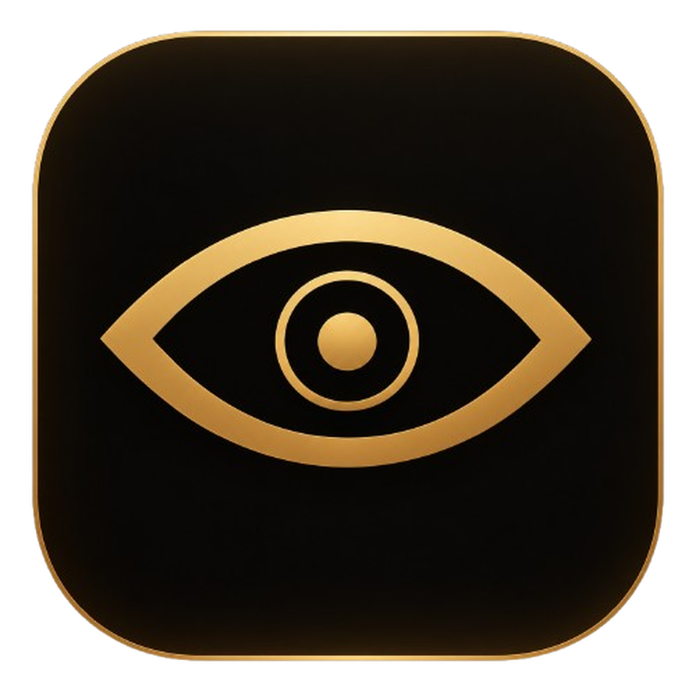

 

  

  

---

## About

Veil launcher is a desktop application for browsing and applying custom League of Legends skin mods. It uses community-maintained skin packages from the [Alban1911/LeagueSkins](https://github.com/Alban1911/LeagueSkins) repository and official splash arts from Riot's Data Dragon CDN.

### Features

- Every champion and every skin in League of Legends, indexed by Riot's official IDs
- One-click install and uninstall with clear status indicators
- Search by champion or skin name; filter by role
- Add custom skin packages via drag-and-drop or direct URL
- Native Windows desktop application

---

## Download

The latest release will be available on the [Releases page](https://github.com/for-tristan/veil-launcher/releases).

> Coming soon.

---

## Legal Disclaimer

This software is **not affiliated with, endorsed by, or sponsored by Riot Games, Inc.** "League of Legends" and all related marks and properties are trademarks of Riot Games, Inc. All champion names, skin names, and splash art assets are the property of Riot Games, Inc. and are used here for identification purposes only.

Custom skin mods are allowed under Riot's Terms of Service for personal, non-commercial use only. **Do not use this software in ranked or competitive play.** Always back up your game files before applying any modifications. The author is not responsible for any damage, account sanctions, or loss of data resulting from the use of this software.

This software is proprietary. See the [LICENSE](./LICENSE) file for full terms. Redistribution, modification, commercial use, and contributions are strictly prohibited.

---

